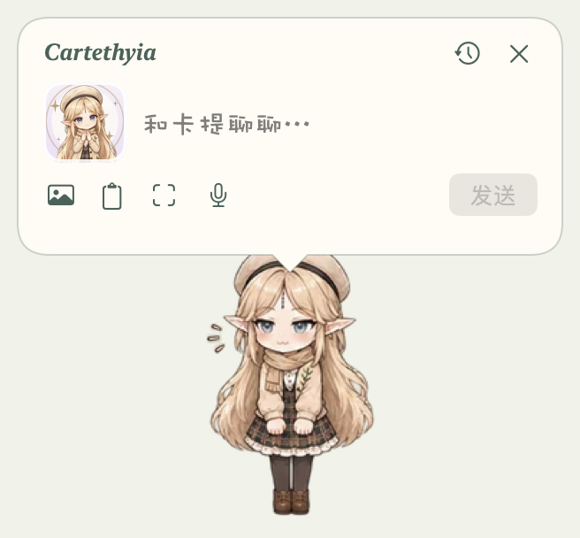
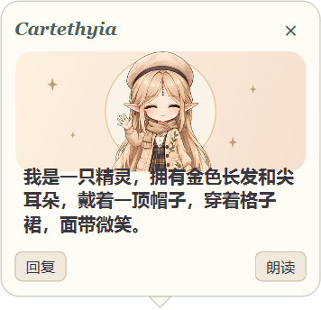
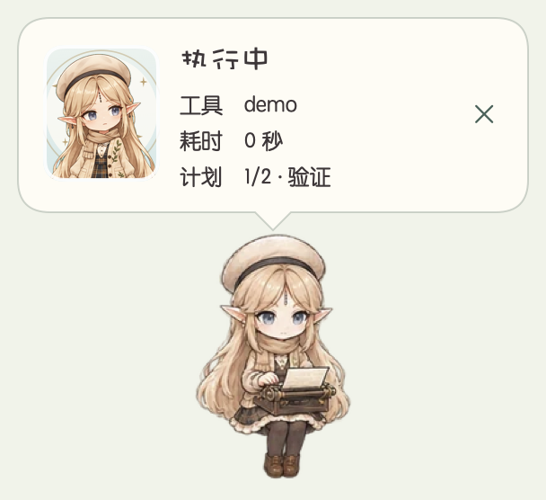
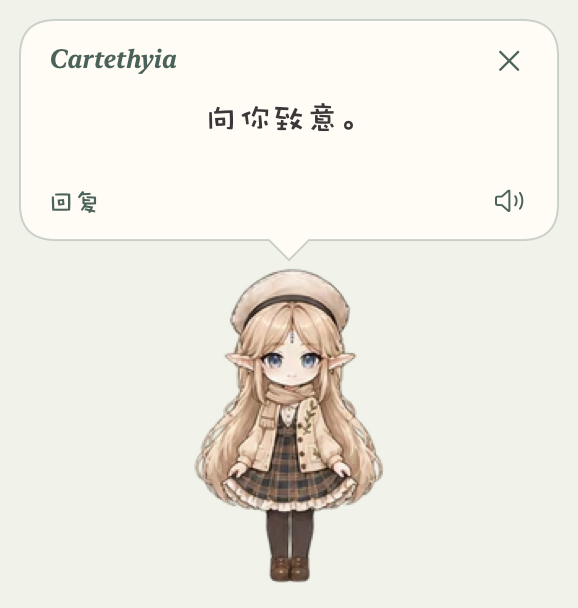
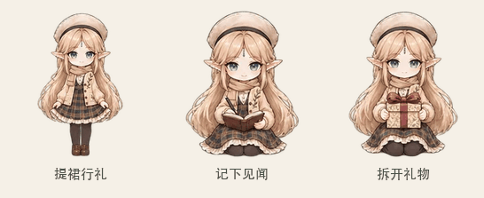

<p align="center">
  <a href="README.md" lang="zh-CN">简体中文</a> · <a href="README.en.md" lang="en">English</a>
</p>

<p align="center"></p>

<h1 align="center">Cartethyia for Codex</h1>

<p align="center">A desktop companion from <em>Wuthering Waves</em> who keeps you company while Codex works.</p>

<p align="center">
  
  <a href="LICENSE"></a>
</p>

## 📸 Interface preview

<table width="100%">
  <tr>
    <td align="center" valign="bottom" width="50%">
      <br>
      <strong>Chat above the pet</strong><br><sub>macOS 0.2.0</sub>
    </td>
    <td align="center" valign="bottom" width="50%">
      <br>
      <strong>An illustrated reply</strong><br><sub>Windows 0.1.0</sub>
    </td>
  </tr>
  <tr>
    <td align="center" valign="bottom" width="50%">
      <br>
      <strong>Tool, elapsed time and plan progress</strong><br><sub>macOS 0.2.0</sub>
    </td>
    <td align="center" valign="bottom" width="50%">
      <br>
      <strong>A curtsy with a timed line of dialogue</strong><br><sub>macOS 0.2.0</sub>
    </td>
  </tr>
</table>

## ✨ Features in action

<p align="center">
  <br>
  <sub>A curtsy, a handwritten note and an unwrapped gift from the macOS 0.2.0 animation library</sub>
</p>

| Feature | What you can do |
| --- | --- |
| Desktop gestures | Drag slowly to leave Cartethyia in the middle of the screen. Draw a quick circle and release to send her bouncing off an edge. Click through the transparent space around her. |
| Work updates | Her pose changes as Codex thinks, uses tools, waits for approval and finishes a task. Click a completion bubble to return to its chat. In 0.2.0, a subagent can finish while the main task keeps running. Cartethyia celebrates when the main turn ends. |
| Animations and illustrations | Version 0.2.0 has 109 individually animated actions. Ask for a curtsy with “给我行个礼”. Right-click **配图** (Illustrations) to pick one of ten pictures. She writes a line to go with your choice. Ordinary replies are text by default. |
| Chat and idle chatter | Click Cartethyia to start a chat. You can edit her persona, interrupt a reply or clear her memory. The default local text model is Qwen2.5-1.5B-Instruct. In 0.2.0, chat and idle chatter can each use a local GGUF model, a compatible API or a model from your Codex account. |
| Quiet hours and profiles | Idle chatter is off by default. Set an interval and quiet hours when you enable it. Focus and mute pause it. Each pet profile keeps its own persona and conversation memory. |
| Quotas and usage | In 0.2.0, **Account quota** shows the remaining allowance and reset time. **Current task usage** breaks out tokens for the main task, its subagents and the companion. Credit and cost figures appear when the official service supplies them. |

## 🔌 Codex plugin

The local **pet-plus** plugin listens for turn, tool and approval events through Codex hooks so Cartethyia can react. You can review the plugin commands in **Codex Settings → Hooks**. Three local MCP tools are available from a Codex chat.

| Tool | What it does |
| --- | --- |
| `pet_status` | Read the latest work state observed by the main pet profile. |
| `pet_remind` | Schedule a reminder with a message and a due time that includes a time zone. It can link back to the current Codex chat. |
| `pet_complete` | Mark a reminder as done using the ID returned when it was created. |

> “Use pet-plus to remind me in 20 minutes to check the test results. Link the reminder to this chat.”

## 💻 System requirements

| Platform | Current release | OS and architecture | Tested configuration |
| --- | --- | --- | --- |
| macOS | **0.2.0** | macOS 27.2 or later on Apple Silicon (M-series) | Apple M4 running macOS 27.2.1 |
| Windows | **0.2.0** | Windows 10 version 1809 (build 17763) or later, or Windows 11, on x64 | Windows 11 Pro, build 22631, x64 |

Work updates and plugin tools require a local Codex installation with plugin support. Work notifications run without a language model. Local text chat works offline once its model is downloaded. Choosing an API or Codex model sends that channel’s messages and relevant context to the selected service.

## 📥 Installation

| Platform | Version 0.2.0 download | SHA-256 |
| --- | --- | --- |
| Windows x64 | **[Download the installer (EXE, 68.0 MiB)](https://github.com/cbhhhhhhh/cartethyia-codex-pet/releases/download/v0.2.0/Cartethyia-0.2.0-Windows-x64-Setup.exe)** | [Windows checksums](https://github.com/cbhhhhhhh/cartethyia-codex-pet/releases/download/v0.2.0/SHA256SUMS-Windows.txt) |
| macOS on Apple Silicon | **[Download the archive (ZIP, 61.3 MiB)](https://github.com/cbhhhhhhh/cartethyia-codex-pet/releases/download/v0.2.0/Cartethyia-Codex-Pet-macOS-arm64.zip)** | [macOS checksums](https://github.com/cbhhhhhhh/cartethyia-codex-pet/releases/download/v0.2.0/SHA256SUMS) |

On Windows, double-click the EXE. On Mac, extract the archive and double-click `安装.command`. Upgrading from 0.1.0 keeps existing settings and chat history. [Windows installation and removal](docs/WINDOWS.md) · [Mac installation and removal](docs/INSTALL-macOS.md)

**[Go to GitHub Releases](https://github.com/cbhhhhhhh/cartethyia-codex-pet/releases)**

## 🗂️ Project structure

```text
art/         Character sprite sheets, app icons and animation clips
src/         Native macOS UI and services for events, chat and reminders
  mcp.py     The three pet-plus MCP tools
  web/       Optional local browser stage and bubble illustrations
windows/     Windows UI, named pipes and Inno Setup installer
scripts/     macOS build, packaging, plugin registration and QA scripts
examples/    Sample settings and custom animation pack configuration
tests/       Turn attribution, chat, usage and desktop interaction tests
docs/        User guides, release notes, platform tests and screenshots
```

Further reading in Chinese · [macOS user guide](docs/GUIDE-macOS.md) · [Windows user guide](docs/WINDOWS.md) · [Architecture](ARCHITECTURE.md) · [Changelog](CHANGELOG.md)

## 📄 License

The project's original software is licensed under the **MIT License**. Cartethyia is a character from Kuro Games’ *Wuthering Waves*. The character illustrations, icons and derived animations remain subject to their respective rights. Bundled runtimes, models and third-party components carry their own licenses. [MIT License](LICENSE) · [Artwork and dependency notices](NOTICE) · [Windows third-party licenses](windows/THIRD-PARTY.txt)
