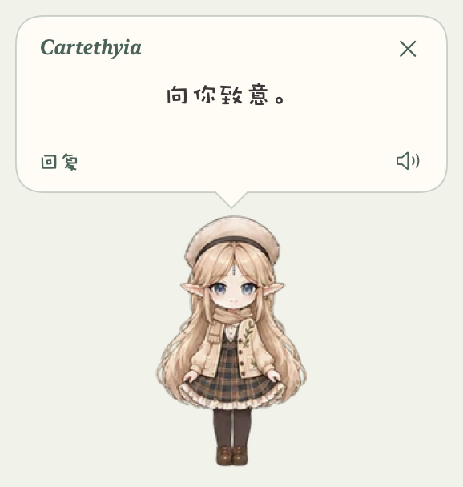

<p align="center">
  <a href="README.md" lang="zh-CN">简体中文</a> · <a href="README.en.md" lang="en">English</a>
</p>

<p align="center"></p>

<h1 align="center">卡提希娅 Codex 桌宠</h1>

<p align="center">让《鸣潮》的卡提希娅住在桌面上，陪你看 Codex 写代码。</p>

<p align="center">
  
  <a href="LICENSE"></a>
</p>

## 📸 界面预览

<table width="100%">
  <tr>
    <td align="center" valign="bottom" width="50%">
      <br>
      <strong>头顶聊天输入框</strong><br><sub>macOS 0.2.0</sub>
    </td>
    <td align="center" valign="bottom" width="50%">
      <br>
      <strong>带角色插画的回复</strong><br><sub>Windows 0.1.0</sub>
    </td>
  </tr>
  <tr>
    <td align="center" valign="bottom" width="50%">
      <br>
      <strong>右键查看工具、耗时与计划</strong><br><sub>macOS 0.2.0</sub>
    </td>
    <td align="center" valign="bottom" width="50%">
      <br>
      <strong>点播行礼时的台词</strong><br><sub>macOS 0.2.0</sub>
    </td>
  </tr>
</table>

## ✨ 功能预览

<p align="center">
  <br>
  <sub>提裙行礼 · 执笔写字 · 拆开礼物　|　macOS 0.2.0 动作节选</sub>
</p>

| 功能 | 在桌面上怎么玩 |
| --- | --- |
| 桌面互动 | 慢拖，把卡提放在屏幕中间；按住她快速画圈再松手，看她飞向屏幕边缘并反弹。角色周围的透明区域可以点穿。 |
| 工作播报 | 思考、使用工具、等待审批和任务结束各有对应动作。点完成气泡可以回到关联的 Codex 会话。0.2.0 会等主回合结束再庆祝，子智能体完成时主任务仍可继续。 |
| 动作与配图 | 0.2.0 的 109 个点播动作各有独立动画。说「给我行个礼」就能点播；右键「配图」可以从 10 张插画里选一张，让她看着图说一句。普通聊天默认用文字。 |
| 聊天与碎碎念 | 单击卡提开始对话，可编辑人设、中断回复或清空记忆。默认本地文字模型为 Qwen2.5-1.5B-Instruct。0.2.0 可分别为对话和碎碎念选择本地 GGUF、兼容 API 或 Codex 账户模型。 |
| 安静陪伴 | 碎碎念默认关闭。开启后可以设定间隔和安静时段，专注或静音时会暂停。不同宠物档案各自保存人设和记忆。 |
| 额度与用量 | 0.2.0 的「账户额度」显示剩余比例和重置时间。「当前任务用量」可分别查看主任务、子会话及桌宠自己的 token，积分与金额以官方接口实际返回的数据为准。 |

## 🔌 Codex 插件功能

本地插件 **pet-plus** 通过 Codex hooks 接收回合、工具和审批事件，桌宠据此切换动作。可在 Codex「设置 → Hooks」审阅插件的命令。插件还提供三个可在 Codex 对话中调用的本地 MCP 工具。

| 工具 | 用途 |
| --- | --- |
| `pet_status` | 读取主档案中桌宠最近观察到的工作状态。 |
| `pet_remind` | 新建到时提醒，接收提醒文字和带时区的到期时间，可关联当前 Codex 会话。 |
| `pet_complete` | 使用创建提醒时返回的 ID，把指定待办标为完成。 |

> 试着在 Codex 里说：「用 pet-plus 在 20 分钟后提醒我检查测试结果，并关联到这个对话。」

## 💻 系统要求

| 平台 | 当前发行版 | 系统与架构 | 已验证环境 |
| --- | --- | --- | --- |
| macOS | **0.2.0** | macOS 27.2 或更新版本，Apple Silicon（M 系列芯片） | Apple M4，macOS 27.2.1 |
| Windows | **0.2.0** | Windows 10 1809（17763）及以上、Windows 11，x64 | Windows 11 专业版，版本 22631，x64 |

工作播报和插件工具需要本机安装支持本地插件的 Codex。只使用工作提醒可以不下载语言模型。本地文字模型首次下载后可离线聊天；选择 API 或 Codex 模型时，该通道的消息和所需上下文会发给所选服务。

## 📥 安装

| 系统 | 0.2.0 安装包 | SHA-256 |
| --- | --- | --- |
| Windows x64 | **[下载安装程序（EXE，68.0 MiB）](https://github.com/cbhhhhhhh/cartethyia-codex-pet/releases/download/v0.2.0/Cartethyia-0.2.0-Windows-x64-Setup.exe)** | [Windows 校验文件](https://github.com/cbhhhhhhh/cartethyia-codex-pet/releases/download/v0.2.0/SHA256SUMS-Windows.txt) |
| macOS · Apple Silicon | **[下载压缩包（ZIP，61.3 MiB）](https://github.com/cbhhhhhhh/cartethyia-codex-pet/releases/download/v0.2.0/Cartethyia-Codex-Pet-macOS-arm64.zip)** | [macOS 校验文件](https://github.com/cbhhhhhhh/cartethyia-codex-pet/releases/download/v0.2.0/SHA256SUMS) |

Windows 用户双击 EXE，Mac 用户解压后双击 `安装.command`。升级 0.1.0 会沿用已有设置和聊天。[Windows 安装与卸载](docs/WINDOWS.md) · [Mac 安装与卸载](docs/INSTALL-macOS.md)

**[前往 GitHub Releases](https://github.com/cbhhhhhhh/cartethyia-codex-pet/releases)**

## 🗂️ 项目结构

```text
art/         角色图集、应用图标、动作清单和透明动画帧
src/         macOS 原生窗口，以及事件、聊天与提醒服务
  mcp.py     pet-plus 的三个 MCP 工具
  web/       可选的本地网页舞台和气泡插画
windows/     Windows 原生窗口、命名管道和 Inno Setup 安装器
scripts/     macOS 构建、打包、插件注册和验收脚本
examples/    桌宠配置与自定义动作包示例
tests/       回合归属、聊天、用量和桌面交互测试
docs/        使用手册、发行说明、平台验收记录与截图
```

[macOS 使用手册](docs/GUIDE-macOS.md) · [Windows 使用手册](docs/WINDOWS.md) · [架构与接口](ARCHITECTURE.md) · [版本记录](CHANGELOG.md)

## 📄 开源协议

项目原创程序代码采用 **MIT 许可证**。卡提希娅是库洛游戏《鸣潮》的角色，角色插画、图标与衍生动画的权利归相应权利人。随包运行时、模型及第三方组件各自适用其许可证。[MIT 全文](LICENSE) · [素材与依赖署名](NOTICE) · [Windows 第三方许可](windows/THIRD-PARTY.txt)
