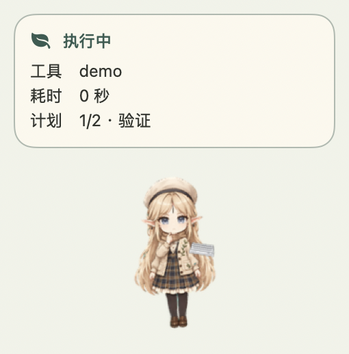
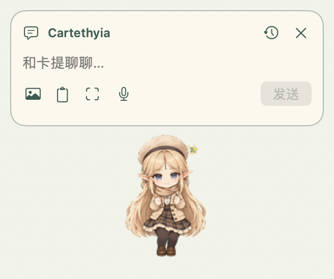
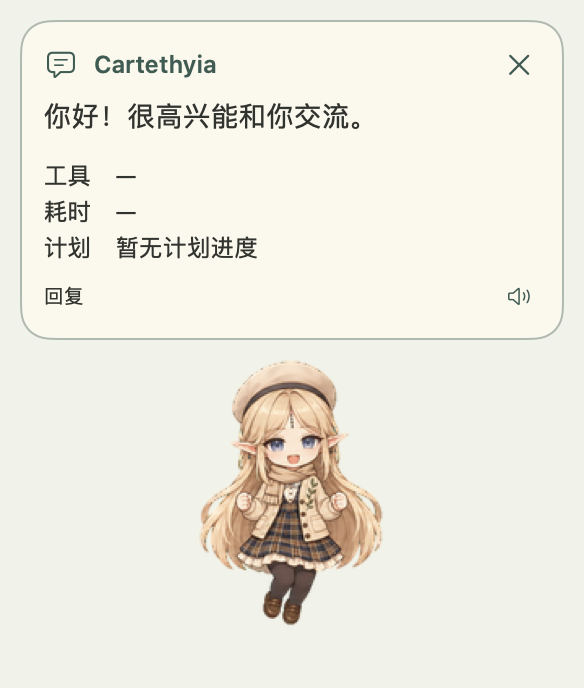

# Cartethyia 2.0 · 桌面交互

当前安装版及最新操作见 [Cartethyia 2.1](DESKTOP-V2.1.md)。本页保留 2.0 的工程验收记录。

## 三个可以直接试的动作

| 操作 | 窗口里的结果 |
| --- | --- |
| 鼠标停在头发、脸或衣服上约 0.24 秒 | 角色旁出现工作卡，列出真实工具、回合耗时和计划完成数。计划有当前步骤时也显示步骤名称。没有来源时显示空值。透明边缘可点穿。 |
| 把卡提慢拖到屏幕中央，停约 0.15 秒再松开 | 卡提停在释放点并记住位置。想抛出去时，在松手前持续向一个方向快速拖动。双击并在第二击中拉开，松手后往反方向发射。 |
| 单击卡提并打字回车 | 输入框贴在角色上方。真实本机模型的回复逐步取代输入框。点击「回复」继续。单独的长窗口由「聊天记录」打开。 |

右键或 Control 点击**角色的身体**打开菜单，可聊天、手动碎碎念、查看工作和额度、查天气、点播动作、开待办、入睡或叫醒、漫游、回到屏幕中央、打开记录、打开 Codex 和设置。屏幕上方空间不足时卡片移到角色下方。悬停时 T 打开输入、D 打开待办、S 切换睡眠，输入框内的字母用于输入。按住话筒可以把系统支持的本地中文听写填入草稿。

## 实际窗口预览

以下图片取自隔离测试中的实际 AppKit 视图。第一张使用测试工具名和两项计划，第三张的文字由本地模型生成。图片按面板当时的屏幕坐标合成，保留了气泡和人物之间的距离。

| 工作详情 | 输入 | 回复 |
| --- | --- | --- |
|  |  |  |

放风筝、拉小提琴和放烟花取自本机生成的角色动作序列。查看[逐帧素材检查](v2-art-qa.json)或[五个实时演出](v2-actions.gif)。

## 与 dsh-pet 的对应关系

对照的上游版本为 `fb38ce620576f5ed3735a99536d2b1a4a9eb313f`，本机 DSH 安装版为 0.4.9。行为依据见[功能说明](https://github.com/PC2005-cloud/dsh-pet/blob/fb38ce620576f5ed3735a99536d2b1a4a9eb313f/FEATURES.md)、[释放速度](https://github.com/PC2005-cloud/dsh-pet/blob/fb38ce620576f5ed3735a99536d2b1a4a9eb313f/dsh-pet/src/shared/physics/release.ts)、[菜单树](https://github.com/PC2005-cloud/dsh-pet/blob/fb38ce620576f5ed3735a99536d2b1a4a9eb313f/dsh-pet/src/shared/menu/tree.ts)、[宿主接口](https://github.com/PC2005-cloud/dsh-pet/blob/fb38ce620576f5ed3735a99536d2b1a4a9eb313f/API.md)。

| 上游功能 | 这套 macOS 安装的实现 |
| --- | --- |
| 工作和提醒 | Codex hook／会话记录进入同一个 reducer。进行中有工作卡，成功、失败和审批有气泡。带 thread 的气泡有返回会话按钮。 |
| 抛掷、弹弓、碰撞 | 指针轨迹决定初速。侧墙、顶边、地面反弹，落地减速，碰撞挤压。档案之间通过本机进程传递位置和碰撞冲量。支持锁定当前显示器。 |
| 角色和动作 | 使用用户已有的两种尺寸 Codex 图集。V2 图集的最后两行提供 16 方向视线。安装时会为上游列出的 109 项动作逐项生成卡提版透明动画，每项 16 帧。右键「点播动作 → 角色包动作」按类别选择。另有 9 个角色动作和 30 个实时场景。 |
| 待机与睡眠 | 可开启漫游、随机动作。睡觉时抑制工作提醒、碎碎念和随机动作；可单独开启梦话，梦话仅出文字。单击叫醒。 |
| 聊天 | 本机多轮、流式回复、取消、人设与表情。0–50 轮可配置上下文，完整历史独立保存。支持选中删除、全部清空、单轮朗读、查看图片。长对话还受本地模型上下文预算限制。 |
| 图片 | 桌面支持文件选择、拖入、从剪贴板粘贴或框选截图。文件限 PNG/JPEG、8 MiB。完整成功轮次保留去重图片。打开「回复附上角色表情」可使用角色帧或自己提供的表情。 |
| 碎碎念与声音 | 手动或定时生成，有独立模型和失败回退。间隔、安静时段、专注、静音均可配置。系统语音输出可选音色和音量，自动碎碎念、对话与手动碎碎念、通知、待办各有播放开关。 |
| 待办 | 所有档案共享 SQLite 清单。支持可选截止时间、完成／重新打开、二次确认删除、提前及过期提醒。Codex 计划另行显示真实进度。 |
| 环境与用量 | 可选本地时间或显式选择城市的天气，包含气温、体感、湿度、风速和降水。Codex 用量只显示会话提供的快照。可选本机适配器支持 DeepSeek 与 OpenCode Go 的公开额度接口。 |
| 多角色与启动模式 | 菜单栏可以创建独立角色档案，各自持有聊天、人设、动画和位置。应用独立运行，可在右键菜单打开浏览器舞台。本机网页支持鼠标、指针与触屏事件，移动传感器需浏览器提供接口和用户授权。 |
| 外部控制 | 按需开启带令牌的回环 HTTP 服务，支持状态、位置、气泡、角色动作、对话、菜单注册和有时限的独占控制。原 Codex 插件的 MCP 和 hook 继续提供会话入口。 |

### 移植范围

本机独立窗口和本机浏览器舞台有自己的协议。DSH 内嵌侧栏、Cordis 服务 ABI、DSH 账号凭据和内部附件库依赖 DSH 宿主。现有 DSH 插件不能直接加载进 Codex；第三方脚本可以使用下面的本地接口。Command Code 上游实现使用未公开的 `/alpha/*` 控制面，当前版本没有该服务的余额入口。浏览器舞台是本机客户程序，手机联网远控、公开发布、Windows/Linux 原生窗口未在这个 macOS 工程中交付。109 套卡提动作采用原角色图集、分镜、道具与运动轨迹在本地合成；美术形式是角色精灵加特效。成品放在本机私有目录，原鱼视频和音效未随包分发。

### 自定义表情和角色动作

把自己的 PNG/JPEG 放入 `~/Library/Application Support/CodexPetPlus/profiles/main/stickers/`，文件名前缀可用 `happy`、`sad`、`curious`、`calm`、`focused` 匹配回复情绪。启用配图后可设最多 1–3 张。余下的档案用各自目录。

角色包里的可选 `pet-plus.json` 定义附加动作、帧数、权重和帧率。每个文件是一张等宽横向序列，支持 1–48 帧，每帧最大 512×512。可指定平时、入睡、睡觉、起床的动作池。设置的状态映射也接受 `clip:动作名`。安装生成的补充包放在 `~/Library/Application Support/CodexPetPlus/appearance/cartethyia/current/`。原有 `~/.codex/pets/cartethyia` 继续由 Codex 管理。如需覆盖补充包，将示例中的文件名替换成自己拥有的图片，放入自己的角色包并用右键「重载配置」。[格式示例](../examples/pet-plus.json)

## 浏览器舞台和自动化接口

右键选「浏览器舞台与本地接口」启动当前档案的服务。浏览器通过 URL 片段接收临时 token，然后从地址栏移除。脚本可读取当前档案私有的 `api.json` 中的 `origin` 和 `token`，独立进程还可以带 `--api` 只开接口，或带 `--browser-only` 以浏览器作为显示端。在请求中发送 `Authorization: Bearer …`。端口每次启动由系统分配。接口只绑定 `127.0.0.1`。

| 接口 | 行为 |
| --- | --- |
| `GET /v1/state` | 工作状态、额度快照、当前气泡、姿势、扩展菜单和最近菜单点击序号。 |
| `GET /v1/history`、`GET /v1/todos`、`GET /v1/models`、`GET /v1/sprite` | 对话记录、清单、模型或当前角色图集。 |
| `POST /v1/control` | JSON 的 `op` 可以是 `say`、`play`、`move`、`throw`、`dismiss`、`chat`、`cancel`、`whisper`、`sleep`、`wake`、`weather`、`quota`、`todos` 或清单／记录操作。`move` 接受 AppKit 全局坐标，`throw` 接受带符号的水平与垂直点/秒。 |
| `POST /v1/image` | 上传 PNG/JPEG 二进制到当前档案，响应中的 `image` 可随 `chat` 发送。 |
| 扩展菜单 | `menu-add` 接受 `id`、`label`，`menu-remove` 移除；点击结果保存在 `state.events`。 |
| 独占一段演出 | `lock` 可带 `seconds`（1–60），返回 `lock`。将该值附在演出指令中，或用 `release` 主动释放；用户拖走或收起桌宠也会收回控制。 |

例如，脚本可向 `/v1/control` 提交 `{"op":"play","action":"骑士礼"}` 或 `{"op":"say","text":"这轮实验已经结束。"}`。此类自定义气泡不会制造 Codex 的成功、失败或进度事件。

可选额度适配器由用户手动启动。例如，运行 `python3 scripts/balance-provider.py deepseek` 后，在「更多」中按需查询；`opencode-go` 可替换 `deepseek`。命令分别从 `DEEPSEEK_API_KEY` 或 `OPENCODE_GO_API_KEY` 读取现有凭据。可选 `--interval 30` 启动定时查询，退出程序可取消注册。默认安装不启动适配器。工程测试使用离线响应样本。[DeepSeek 官方接口](https://api-docs.deepseek.com/api/get-user-balance/) · [OpenCode Go 官方接口](https://opencode.ai/docs/console/go/#usage)

动作编排可以用 `sequence` 提交 `steps`，每步包含 `action` 和 `seconds`。响应中的 `id` 可用于 `GET /v1/playback/<id>` 取执行状态，`stop-sequence` 终止。`move` 可指定 `normalized: true` 和 `mode: "linear"` 或 `"spring"`。`GET /v1/clips` 提供可用序列和帧率。公开接口与 Codex 会话事件共用同一只角色。

## 验收与回退

- 真实 AppKit 菜单收到开始弹出的系统通知。普通应用窗口事件覆盖轻放、水平抛出、反向弹弓和松手后留在半空。工作卡验收使用本地 hook 和两项计划；聊天验收经过文本编辑器的提交入口、真实本机推理、流式文字、归档和最终气泡。锁屏状态下无法验收解锁桌面的前台键盘焦点。[原生结果](native-qa.json)
- 独立的 Chrome 测试用真实鼠标右键和按键事件检查网页菜单、输入焦点、提交后气泡、待办和历史。网页测试使用隔离测试服务。[浏览器结果](v2-web-qa.json)
- 设置重启、事件服务崩溃回 idle、Codex 本机回合、语音合成、图片和静音节流分别有测试。麦克风实录、物理第二显示器、手机传感器和用户实际扬声器音量需要对应硬件。[服务恢复](recovery-qa.json) · [聊天](conversation-qa.json) · [视觉](vision-qa.json) · [语音](tts-qa.json) · [碎碎念](whisper-qa.json)
- 2.0 曾保留上一版应用用于回退。2.1 已按用户要求清理该副本。运行 `./uninstall.sh` 完整卸载。卸载会删除独立伙伴的个人聊天、设置和模型副本；保留这些数据时应先备份档案。原游戏二创图集位于 Codex 自己的宠物目录。

已安装应用的双窗口实测包含碰撞冲量、独占动作序列、带令牌的气泡、真实 GGUF 回复和独立档案。卸载在隔离本机用户目录中走真实 Codex 插件注册与卸载流程，比对配置字节和原角色图集。[安装版结果](v2-installed-qa.json) · [卸载复验](v2-uninstall-qa.json)

真实隔离 Codex 回合开始后，窗口在 203 毫秒显示思考动画，回合结束后 699 毫秒回到待机。另测可见窗口在启用随机动作、没有接收任务的 144.74 秒内，桌宠和事件服务合计平均 CPU 为 0.884%，最高 12 秒区间为 1.326%，常驻内存峰值 126.92 MiB。本地模型推理会另行占用内存。[原生窗口测量](native-qa.json) · [空闲资源测量](v2-isolated-idle.json)

异步 hook 发送器在预热后连续启动 62 次，中位耗时 3.38 毫秒，P95 为 3.72 毫秒，最慢 4.51 毫秒。新复制的可执行文件首次启动实测 596 毫秒，首次启动不满足 50 毫秒预算。Codex 将这些命令作为异步 hook 调度。[hook 测量](v2-hook-benchmark.json)

### 安装版连续两小时测试

Cartethyia 2.0 的同一对桌宠和事件服务进程连续运行 **7,200.07 秒**。241 次采样均找到原进程。两小时内运行了 9 次使用本机测试端点的隔离 Codex CLI 回合，全部正常结束，单次墙钟耗时 1.629–1.724 秒。测试机处于锁屏状态，CLI 探测覆盖回合执行，Codex 前台滚动、键入的帧率仍待人工检查。[逐次采样](v2-soak.json) · [9 次回合](v2-cli-probes.json)

| 两个常驻进程合计 | 实测 |
| --- | --- |
| 常驻内存 | 中位数 132.67 MiB，峰值 154.23 MiB。前 10 分钟预热后的中位数 133.88 MiB，最后 10 分钟 106.47 MiB。 |
| 连续空闲时的 CPU | 176 个空闲区间，共 5,291.47 秒；按累计 CPU 时间计算，平均 1.412%，30 秒区间 P95 为 1.630%，最高 1.697%。`ps` 的空闲瞬时读数最高为 5.5%。 |
| macOS `leaks` | 开始和结束各检查一次。桌宠和事件服务两次均返回 0 块、0 字节。 |

常驻内存与 CPU 仅计桌宠和事件服务。聊天和识图所用的本地推理子进程按需启动，加载权重时会额外占用内存。[稳定性汇总](v2-stability-summary.json) · [累计 CPU 采样](v2-idle-cpu.json) · [起始泄漏检查](v2-initial-leaks.json)
